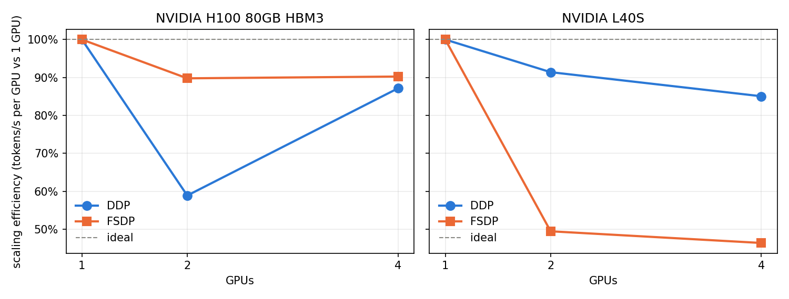

# Distributed LoRA fine-tuning: scaling

Gemma 4 E4B, LoRA r=16, bf16, real email rows, 2 rows per GPU per step (weak scaling). Throughput is real (non-padding) tokens per second over a fixed window of training steps; the comm share is NCCL kernel time over all CUDA kernel time on 2 profiled steps, rank 0. Versions: torch 2.8.0+cu128, transformers 5.20.2, trl 1.16.0, peft 0.21.2, accelerate 1.15.0.

## NVIDIA H100 80GB HBM3

| Strategy | GPUs | Samples/s | Tokens/s per GPU | Efficiency | Peak GiB (max rank) | Comm % | Final loss |
|---|---|---|---|---|---|---|---|
| ddp | 1 | 4.63 | 2734 | 100.0% | 16.3 | 0.0% | 0.038 |
| ddp | 2 | 5.56 | 1610 | 58.9% | 16.4 | 16.8% | 0.062 |
| ddp | 4 | 16.75 | 2383 | 87.1% | 16.5 | 20.5% | 0.024 |
| fsdp | 1 | 3.69 | 2183 | 100.0% | 30.1 | 0.0% | 0.038 |
| fsdp | 2 | 6.77 | 1960 | 89.8% | 22.7 | 72.2% | 0.053 |
| fsdp | 4 | 13.85 | 1970 | 90.2% | 18.9 | 68.5% | 0.022 |
## NVIDIA L40S

| Strategy | GPUs | Samples/s | Tokens/s per GPU | Efficiency | Peak GiB (max rank) | Comm % | Final loss |
|---|---|---|---|---|---|---|---|
| ddp | 1 | 3.80 | 2246 | 100.0% | 16.3 | 0.0% | 0.038 |
| ddp | 2 | 7.09 | 2053 | 91.4% | 16.4 | 9.0% | 0.061 |
| ddp | 4 | 13.43 | 1910 | 85.0% | 16.4 | 18.2% | 0.023 |
| fsdp | 1 | 2.97 | 1757 | 100.0% | 30.1 | 0.0% | 0.038 |
| fsdp | 2 | 3.00 | 869 | 49.4% | 22.6 | 71.7% | 0.057 |
| fsdp | 4 | 5.73 | 815 | 46.4% | 18.8 | 74.9% | 0.021 |

